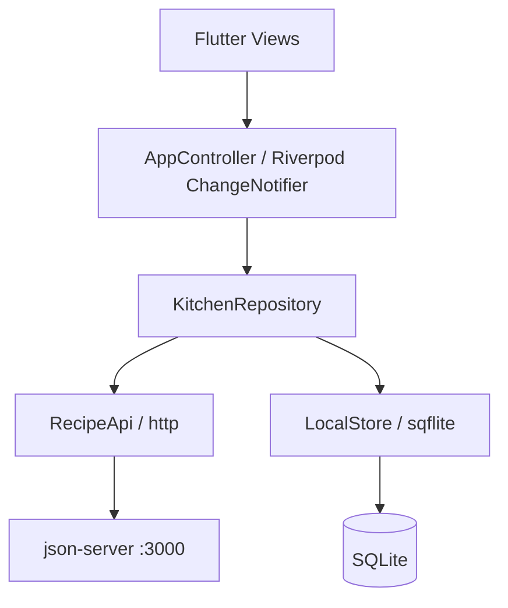

# NauGi — Hôm nay nấu gì?

> Đồ án Mobile Application Development (INT1449), PTIT.
>
> Sổ tay bếp tiếng Việt: chọn công thức, lên thực đơn, tận dụng tủ lạnh và chuẩn bị danh sách mua, có dữ liệu cục bộ dùng khi mất mạng.

Đọc [đề bài và thang điểm](INSTRUCTION.md), [hướng dẫn sinh viên](docs/student-guide.md) và [quy trình môn học](GETTING_STARTED.md). Hướng dẫn chạy riêng của NauGi ở mục 5.

## 1. Team (mandatory)

Sinh viên tự điền thông tin thực tế; không gán tên hoặc công lao từ mã được nhập hay AI tạo.

| # | Full name | Student ID | Class | GitHub | Role |
|:-:|-----------|:----------:|:-----:|--------|------|
| 1 | | | | @ | |
| 2 | | | | @ | |
| 3 | | | | @ | |

**Topic:** Sổ tay công thức, thực đơn, tủ lạnh và mua sắm cá nhân có hỗ trợ offline.

## 2. Problem & Idea (mandatory)

Người tự nấu ăn khó nối công thức với nguyên liệu sẵn có và danh sách cần mua. NauGi hướng tới sinh viên ở trọ và gia đình nhỏ: xem công thức dùng chung qua REST, lập thực đơn, nhập tủ lạnh và sinh danh sách mua trên điện thoại.

Phần đáng chú ý là ranh giới online/offline: danh mục công thức/nguyên liệu dùng chung đọc và ghi qua HTTP; thực đơn, tủ lạnh, mua sắm, sở thích, yêu thích và ảnh lưu SQLite. Bản chụp công thức trong thực đơn giữ bữa cũ khi món gốc sửa/xóa. Gợi ý theo quy tắc, không dùng Gemini/LLM.

Phạm vi không gồm đăng nhập, dữ liệu riêng trên cloud, đồng bộ đa thiết bị, upload ảnh hoặc tự đồng bộ thao tác ghi công thức offline. Xem [đề xuất](docs/proposal.md).

## 3. Screenshots & Features

Màn hình: Hôm nay, Công thức, Chi tiết, Tạo/sửa công thức, Thực đơn, Tủ lạnh, Mua sắm, Cài đặt, Nguyên liệu và Gợi ý.

- Công thức/nguyên liệu dùng chung qua REST; món mẫu chỉ sao chép từ UI.
- Thực đơn, tủ lạnh, danh sách mua và tùy chọn sửa cục bộ cả khi offline.
- Cache danh mục cho lần mở sau; refresh lỗi giữ cache và hiển thị cảnh báo/retry.
- Yêu thích và ảnh riêng trên từng thiết bị.
- Tính định lượng/dinh dưỡng với thông báo thiếu dữ liệu; gợi ý giải thích được.

Ảnh chụp thật trên Android emulator API 35, kích thước 320 × 640, app kết nối json-server thử ở cổng 3307: [Hôm nay](docs/asset/naugi-android-home.png), [Công thức](docs/asset/naugi-android-recipes.png), [Chi tiết](docs/asset/naugi-android-detail.png). Ảnh bổ sung từ Flutter widget test 412 × 915 dùng API giả: [Hôm nay](docs/asset/naugi-home-widget.png), [Chi tiết](docs/asset/naugi-recipe-widget.png).

## 4. Architecture



| Thành phần | Lựa chọn | Lý do |
|---|---|---|
| Framework | Flutter, ưu tiên Android | Giữ UI và logic NauGi, một codebase |
| State | Riverpod + ChangeNotifier | Truy vết hành động rõ, phù hợp đồ án |
| HTTP | package http, timeout 15 giây | Phân biệt lỗi HTTP/mạng/JSON |
| Lưu local | sqflite, Notebook JSON | Giữ dữ liệu cá nhân và cache bền |
| Backend | json-server 0.17.4 | REST dễ chạy và quan sát cho demo |

View không gọi API hoặc SQL trực tiếp. Chi tiết: [architecture.md](docs/architecture.md), [api-integration.md](docs/api-integration.md).

## 5. Quick Start

Yêu cầu: Flutter stable **3.47.7**, Node.js **>=20**, Android SDK và emulator/thiết bị Android. Cài đặt Android SDK, license và thiết bị qua công cụ Flutter/Android của máy; chạy flutter doctor để xem phần còn thiếu. Không cần Supabase hoặc API key.

Mở terminal tại repository:

```powershell
cd backend
npm ci
npm start
```

Backend mặc định cổng 3000. Lần đầu tạo backend/runtime/db.json từ backend/seed.json; runtime không commit. Dừng API trước khi npm run reset để chủ động khôi phục seed; reset làm mất thay đổi demo. Nếu cổng 3000 đã bị chiếm, dừng dịch vụ đó hoặc đặt PORT khác và sửa API_BASE_URL tương ứng. Chi tiết: [backend/README.md](backend/README.md).

Mở terminal khác:

```powershell
cd app
flutter pub get
flutter run --flavor demo --dart-define-from-file=config/dev.example.json
```

| Chạy ở đâu | API_BASE_URL |
|---|---|
| Android emulator | http://10.0.2.2:3000 |
| iOS simulator | http://localhost:3000 |
| Thiết bị thật | http://IP-LAN-MAY-CHU:3000 |

App nhận API_BASE_URL qua dart-define từ file JSON. File mẫu: app/config/dev.example.json, ios.example.json và device.example.json. Có thể sao chép thành app/config/dev.json để cấu hình riêng; không đưa bí mật vào cấu hình. Máy thật cần cùng LAN, backend mở cổng phù hợp và firewall cho phép truy cập.

Android flavor **demo** cho phép HTTP phục vụ API đồ án. Flavor **production** giữ chính sách HTTP hạn chế; không dùng thiết lập demo để suy ra bảo mật triển khai thật.

Lệnh kiểm tra và build, chạy trong app:

```powershell
flutter analyze
flutter test
flutter build apk --flavor demo --release --dart-define-from-file=config/dev.example.json
```

APK demo đã build ngày 19/10/2026: `app/build/app/outputs/flutter-apk/app-demo-release.apk` (62.913.914 byte). Tệp build nằm ngoài Git; clone mới chạy lệnh trên để tạo lại. Chi tiết hash và giới hạn kiểm tra: [testing-guide.md](docs/testing-guide.md).

Helper tùy chọn:

```powershell
# Từ repository; auto chọn Docker khi daemon sẵn sàng, nếu không dùng Node
.\scripts\api.ps1 -Action start -Mode auto

# Từ app; Action: run, test, analyze, build, integration
.\tool\naugi.ps1 -Action run -ConfigPath config/dev.example.json
```

Node fallback chạy foreground, Ctrl+C để dừng. Backend helper còn có stop/logs/reset; xem [backend/README.md](backend/README.md). Helper app có -DeviceId khi cần chọn thiết bị.

## 6. Test Evidence

Backend đã chạy kiểm tra cú pháp, 3/3 test và export seed kiểm tra 20 công thức/25 nguyên liệu trong phiên chuyển đổi. Flutter analyze đạt, 62/62 test đạt trong workspace và bản clone sạch. APK demo đã build cả từ bản clone sạch; kiểm tra tích hợp Android qua REST thật và SQLite thật đạt 1/1 trên emulator. Kịch bản, môi trường và giới hạn nằm trong [testing-guide.md](docs/testing-guide.md).

Các kịch bản airplane mode thủ công, timeout, xoay màn hình, kích thước khác nhau và permission có danh sách kiểm tra riêng, đang chờ bằng chứng nếu chưa ghi kết quả. Ảnh trong mục 3 ghi rõ ảnh Android và ảnh widget test.

## 7. Documentation

| Tài liệu | Nội dung |
|---|---|
| [proposal.md](docs/proposal.md) | Vấn đề, người dùng, phạm vi và đánh đổi |
| [ui-design.md](docs/ui-design.md) | Persona, luồng, màn hình, wireframe, token, 4 trạng thái |
| [architecture.md](docs/architecture.md) | Phân lớp, state, dữ liệu và offline |
| [api-integration.md](docs/api-integration.md) | REST, cấu hình và lỗi |
| [testing-guide.md](docs/testing-guide.md) | Cách chạy, kết quả thật và kịch bản chưa xác minh |
| [migration-plan.md](docs/migration-plan.md) | Các giai đoạn và bảo toàn dữ liệu cũ |
| [source-provenance.md](docs/source-provenance.md) | URL/commit nguồn, phạm vi kế thừa và quyền dùng |
| [oral-defense.md](docs/oral-defense.md) | Đường lần mã, câu hỏi và bài tập thay đổi |
| [ai-log.md](docs/ai-log.md) | Nhật ký dùng AI, sinh viên tự ghi phần đã giữ/kiểm chứng |

## 8. AI Disclosure (mandatory)

Chính sách: [INSTRUCTION.md §7](INSTRUCTION.md#7-ai-usage-policy). Sinh viên chịu trách nhiệm giải thích mọi mã được nhận, kể cả mã AI tạo và mã kế thừa.

### 8.1 Summary

Bản nháp công khai việc hỗ trợ trong phiên chuyển đổi; nhóm tự bổ sung người dùng công cụ, đối chiếu diff và xác nhận mức độ.

| Tool / model | Used by | Used for | Files / modules | Level |
|---|---|---|---|---|
| OpenAI Codex | Sinh viên tự điền | Chuyển NauGi sang REST/SQLite theo phạm vi đã chọn; công cụ, kiểm thử và tài liệu | app/, backend/, scripts/, docs/, README | Generated draft — cần nhóm review/kiểm chứng |

Mức Generated ở đây mô tả bản nháp do AI tạo, không khẳng định nhóm đã kiểm chứng hoặc có thể giải thích. Sinh viên tự ghi kết quả vào AI log.

### 8.2 Decisions we made ourselves

Các lựa chọn người dùng đã xác nhận cho lần chuyển đổi: giữ Flutter Android; dùng json-server, không auth; recipe/ingredient dùng chung; dữ liệu cá nhân local; công thức ghi khi online. Đánh đổi được ghi trong proposal và architecture để nhóm đọc lại, xác nhận và bảo vệ.

### 8.3 Where AI was wrong — and how we found out

Chưa có ví dụ do sinh viên xác nhận trong bản nháp này. Nhóm bổ sung lỗi/giả định sai cụ thể đã thực sự phát hiện, cách tái hiện và cách sửa; không tạo câu chuyện kiểm chứng giả.

### 8.4 Full log

Xem [docs/ai-log.md](docs/ai-log.md). Nguồn NauGi kế thừa được ghi riêng trong [source-provenance.md](docs/source-provenance.md).

---

## 9. Contribution (mandatory)

| Member | Owns (modules / documents) | Key PRs / commits | AI-assisted parts | Contribution % |
|--------|----------------------------|-------------------|-------------------|:--------------:|
| | *(e.g., Expenses feature: screen → ViewModel → repository; `docs/ui-design.md`)* | *(e.g., #3, #7)* | *(e.g., chart widget — Generated)* | |
| | | | | |
| | | | | |

We confirm the table above is accurate and agreed by all members:

- [ ] Member 1
- [ ] Member 2
- [ ] Member 3

---

<sub>Based on the [mobile-app-starter](https://github.com/hungdn1701/mobile-app-starter) template by Hung N. Dang.</sub>
