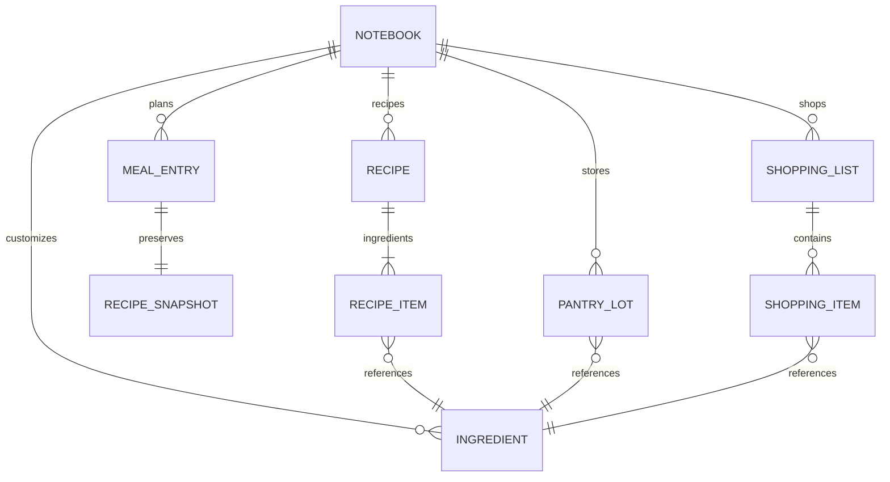

# Kiến trúc NauGi

## Luồng ứng dụng

Flutter UI → AppController (Riverpod/ChangeNotifier) → domain → SQLite hoặc Supabase.
GoRouter quản lý màn hình chi tiết. Không có bí mật máy chủ trong Flutter.

Khách lưu SQLite, không cần mạng. Tài khoản tải máy chủ khi mở/đăng nhập và khi bấm Đồng bộ;
mọi thao tác ghi chờ máy chủ xác nhận. Nếu không tải được máy chủ, đọc cache riêng và khóa chỉnh sửa.
Không có đồng bộ realtime hoặc hàng đợi offline cho tài khoản trong v1.

## Lưu trữ và xung đột

SQLite `notebooks(scope, payload)` tách `guest` và `account:<uid>`.
Supabase `notebooks(user_id, payload, revision, updated_at)` lưu một document JSONB cho mỗi người.
Document gồm recipes, ingredients, meals, pantry, lists, preferences, schemaVersion=1.
Các thực thể trong document có ID ổn định; khóa ngoại bên trong được quản lý bởi nghiệp vụ.

Đây là lựa chọn triển khai v1 thay cho việc tách mọi thực thể thành bảng: lưu một lần có tính nguyên tử
cho chuyển dữ liệu khách và thực đơn/danh sách, giảm các lỗi cập nhật dở dang.
Đổi lại mỗi lần lưu gửi toàn bộ sổ tay, giới hạn 5 MB/2.000 mục mỗi tập hợp và chưa tối ưu cho dữ liệu lớn.
Không lưu ảnh nhị phân trong document. Có thể tách bảng trong migration sau khi cần truy vấn lớn/realtime.

RPC `save_notebook(document, expected_revision)` dùng auth.uid(), không nhận user_id từ client.
Revision không khớp thì từ chối, yêu cầu tải lại. Không âm thầm ghi đè thay đổi trên thiết bị khác.
Ghi thành công nhưng cache thất bại vẫn giữ kết quả máy chủ và báo rõ giới hạn offline.

Ghép khách dùng ID ổn định, account thắng nếu cùng ID. Tài khoản chưa có document nhận sở thích khách;
tài khoản đã có document giữ sở thích hiện có. Chỉ xóa guest sau khi RPC xác nhận.
Nếu phản hồi máy chủ bị mất, tải lại rồi nhập lần nữa vẫn không nhân đôi ID.

## Quan hệ dữ liệu trong document

Mẫu công thức và nguyên liệu tham chiếu được đóng gói cùng app; recipe_catalog là bản mẫu phía server.
Chạy `dart run tool/export_seed.dart` sau khi thay mẫu để cập nhật seed đồng nhất.

## Ảnh và thông báo

Ảnh khách được copy từ vùng tạm vào documents. Khi lưu tài khoản hoặc nhập khách,
ảnh được upload private bucket theo `<uid>/<file-id>.jpg` và document lưu `cloud:<path>`.
Ảnh tải theo nhu cầu, cache trong thư mục riêng của tài khoản; đăng xuất xóa cache tài khoản và hủy nhắc hạn.
Ảnh không còn tham chiếu trên Storage chưa được tự dọn; xóa thủ công khi cần kiểm soát dung lượng đồ án.

Thông báo dùng timezone thiết bị và báo thức không chính xác tuyệt đối; không xin quyền exact alarm.
Lịch được tạo lại khi mở dữ liệu và sau thay đổi, giới hạn 200 mốc gần nhất.
Thay đổi từ máy khác chỉ cập nhật lịch trên thiết bị sau khi tải/đồng bộ lại.

## AI và dinh dưỡng

`suggest-recipes` nhận tối đa 30 candidateIds; server lấy dữ liệu thật, lọc lại sở thích,
xác thực JWT và trừ quota nguyên tử. Gemini chỉ nhận món, nguyên liệu, sở thích và hạn sử dụng;
không gửi email, UID hoặc ảnh. Phản hồi được kiểm tra ID, trùng lặp, số lượng và độ dài lý do ở cả server/client.
Mọi lỗi AI hiển thị không khả dụng. Gợi ý rule-based là một khu vực độc lập, không phải fallback giả AI.

Dinh dưỡng chạy thuần Dart. Tính theo nguyên liệu sống và phần ăn được; g/kg và quả/cái có khối lượng tham chiếu.
Không dùng AI để suy đoán calo. Không có dữ liệu hoặc không quy đổi được thì đánh dấu thiếu và chỉ cộng phần đã biết.
Mỗi bữa/ngày cộng dinh dưỡng toàn bộ các khẩu phần đã lên kế hoạch, không gán cho cá nhân.

## Quyền truy cập

RLS chỉ cho đọc notebook của chính mình; direct writes bị thu hồi, mọi ghi qua RPC.
Bucket private kiểm tra thư mục UID cho select/insert/update/delete. recipe_catalog chỉ đọc.
Quota table không cho client đọc/ghi; RPC quota chỉ service_role được gọi.
SQL regression tests nằm trong `supabase/tests/rls.sql`, chạy trên DB thử nghiệm rồi rollback.
