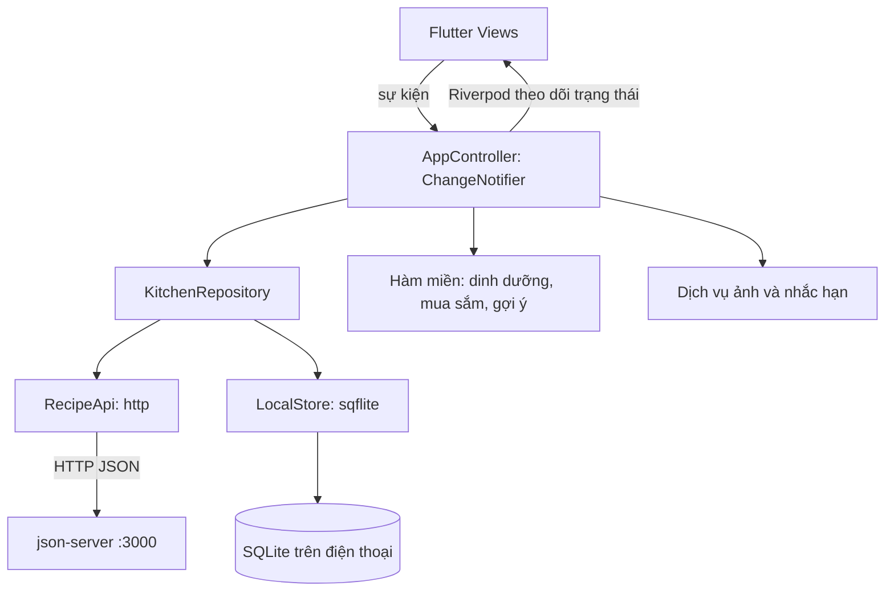

# Kiến trúc NauGi

## Ranh giới hệ thống

NauGi là ứng dụng Flutter ưu tiên Android, dùng danh mục công thức/nguyên liệu dùng chung qua REST và dữ liệu cá nhân trong SQLite. Phiên bản chuyển đổi không đăng nhập hoặc đồng bộ riêng giữa thiết bị. json-server 0.17.4 phục vụ cổng 3000 cho môi trường đồ án.

View chỉ đọc trạng thái và gọi controller. Không mở SQLite hoặc gọi HTTP trong widget. Repository quyết định nguồn dữ liệu, refresh và cache.

## Thành phần

| Thành phần | Trách nhiệm |
|---|---|
| lib/ui/, main.dart | Điều hướng, widget, nhập liệu, hiển thị trạng thái |
| lib/app_controller.dart | Trạng thái màn hình, hành động và thông báo |
| lib/data/kitchen_repository.dart | Nguồn dữ liệu, refresh, cache, ghi remote và local |
| lib/data/recipe_api.dart | URL cấu hình, HTTP, timeout, mã lỗi và JSON |
| lib/data/local_store.dart | Mở SQLite, đọc/ghi Notebook và nâng cấp dữ liệu |
| lib/domain/ | Mô hình, LoadState, AppFailure và hàm tính toán |
| lib/services/ | Lưu ảnh trên máy và tích hợp nhắc hạn |

Riverpod cung cấp và theo dõi một AppController dựa trên ChangeNotifier. Cách này phù hợp đồ án và giúp truy vết hành động. Đánh đổi là controller tập trung nhiều luồng và notifyListeners có thể làm nhiều widget dựng lại; khi mở rộng nên tách theo tính năng, giữ repository. Đây không phải mô hình Bloc hoặc AsyncNotifier riêng cho từng màn hình.

## Mô hình dữ liệu

| Đối tượng | Trường chính | Nơi lưu / ý nghĩa |
|---|---|---|
| Recipe | id, name, description, category, minutes, servings, vegetarian, sample, items, steps | REST và cache; items tham chiếu ingredientId |
| Ingredient | id, name, per100g, gramsPerPiece, source | REST và cache; dinh dưỡng có thể thiếu |
| MealEntry | id, date, meal, servings, recipe | Local; recipe là bản chụp |
| PantryLot | id, ingredientId, amount, unit, expiry | Local; mỗi lô có hạn riêng |
| ShoppingList / ShoppingItem | id, name, items; lượng, đơn vị, purchased | Local |
| Preferences | vegetarian, servings, maxMinutes, avoided, reminders | Local |
| Notebook | schemaVersion, hasRemoteCache, recipes, ingredients, meals, pantry, lists, preferences, favoriteIds, localImages, draftRecipes, draftIngredients | Gói dữ liệu SQLite |

LocalStore giữ Notebook dạng JSON trong SQLite; không phải mỗi entity có một bảng quan hệ riêng. Ưu điểm là gần mô hình nguồn và dễ chuyển đổi; nhược điểm là ghi lại gói dữ liệu, không truy vấn/index từng món. schemaVersion phân biệt dạng dữ liệu cũ; hasRemoteCache phân biệt đã tải REST thành công với lần đầu chưa tải.

## Đọc và bốn trạng thái

1. Khởi tạo LocalStore và nạp dữ liệu cũ.
2. Dùng cache đã có trong khi yêu cầu GET recipes và ingredients.
3. Khi cả danh mục tải hợp lệ, thay phần cache, giữ dữ liệu cá nhân và lưu SQLite.
4. Chuyển success nếu có dữ liệu, empty nếu kết quả hợp lệ rỗng. Kết quả rỗng phải thay cache cũ để không giữ món đã bị xóa trên server.
5. Mất kết nối, timeout hoặc JSON hỏng chuyển error với retry; cache cũ vẫn dùng được. Lần đầu chưa có cache hiện lỗi, không tự dùng seed đóng gói rồi báo thành công.

loading cho biết đang có thao tác; success là có kết quả; empty là kết quả hợp lệ không có phần tử; error là không hoàn tất tải/lưu. Lỗi refresh kèm cache vẫn cần cảnh báo. Lỗi khởi tạo SQLite cần có đường thử lại.

## Ghi REST và dữ liệu cá nhân

Công thức mới dùng UUID ổn định do client tạo trước POST; sửa dùng PUT cùng ID; xóa dùng DELETE. Chỉ báo lưu thành công khi remote trả kết quả thành công. Không tự gửi lại thao tác ghi sau timeout: máy chủ có thể đã ghi dù client chưa nhận phản hồi. Cần tải lại hoặc kiểm tra ID trước khi thử lại.

Công thức sample bị khóa sửa/xóa trên UI; sao chép tạo UUID mới và sample=false rồi ghi remote. Đây là quy tắc ứng dụng, không phải phân quyền bảo mật trên json-server.

Yêu thích lưu trong favoriteIds; ảnh trong localImages[recipeId]. HTTP không gửi yêu thích hoặc đường dẫn file riêng của máy. Thực đơn, tủ lạnh, danh sách mua và tùy chọn ghi SQLite, không có hàng đợi đồng bộ cá nhân lên server.

## Offline và thay đổi dữ liệu

| Tình huống | Hành vi |
|---|---|
| Mất mạng sau lần tải thành công | Đọc cache, cảnh báo, retry; dữ liệu cá nhân tiếp tục chỉnh sửa |
| Lần đầu mở không mạng | Lỗi danh mục; không giả thành công bằng seed |
| Món server bị sửa/xóa | Refresh thay danh mục; bữa cũ giữ bản chụp |
| Yêu thích trỏ tới món đã xóa | Không tự tạo lại món remote |
| Tạo/sửa công thức offline | Không báo lưu thành công; form cần giữ để xử lý |
| App bị đóng | Notebook tồn tại; vị trí điều hướng/form chưa lưu cần kiểm thử riêng |

Bản chụp giữ nội dung công thức nhưng không đóng băng danh mục dinh dưỡng. Sửa thông tin nguyên liệu có thể đổi phép tính dinh dưỡng; không coi đây là hồ sơ lịch sử dinh dưỡng chính xác.

## Quy tắc miền có thể bảo vệ

engine.dart tính lượng theo tỷ lệ khẩu phần. Chỉ đổi kg↔g, l↔ml; không tự xem ml là g. Chỉ đổi quả/cái sang gram khi có gramsPerPiece. Khi thiếu dữ liệu, dinh dưỡng phải báo chưa đầy đủ.

Danh sách mua gộp theo nguyên liệu, đơn vị chuẩn và có/không định lượng. Chỉ trừ lô chưa hết hạn cùng đơn vị. “Vừa đủ” không trộn vào lượng đã biết. Gợi ý lọc theo thời gian, ăn chay và nguyên liệu tránh; xếp hạng bằng tỷ lệ nguyên liệu có sẵn, ưu tiên hạn gần và thời gian nấu. Không có Gemini/LLM trong luồng này.

## Cấu hình và chuyển đổi

API_BASE_URL nhận qua --dart-define hoặc file JSON. Android emulator dùng 10.0.2.2, thiết bị thật dùng LAN IP máy backend. Flavor demo cho phép HTTP phục vụ đồ án; Android thông thường giữ chính sách hạn chế HTTP.

Dữ liệu guest cũ được sao lưu tại scope migration-backup-v1 và chuyển sang schemaVersion 2 trong scope guest theo [migration-plan.md](migration-plan.md). Không tự nhập dữ liệu account, không gửi ngầm dữ liệu cá nhân lên danh mục dùng chung. Chi tiết REST: [api-integration.md](api-integration.md).

## Chống ghi đè và kết quả lưu từng phần

Repository xếp các commit local vào một chuỗi Future, để một snapshot cũ không ghi đè cache mới. Chờ mạng không khóa chuỗi ghi local; thao tác tủ lạnh/yêu thích vẫn tiếp tục khi refresh chậm. Bộ đếm generation và refreshId loại kết quả GET cũ khi có refresh mới hoặc thao tác ghi remote xen vào.

Trước khi lưu công thức/nguyên liệu, repository GET cùng ID. Nếu bản ghi đã tồn tại và giống nội dung, dùng lại; nếu ID mới trùng nhưng khác nội dung, báo xung đột thay vì ghi đè. Bản đang sửa đã bị server xóa sẽ báo lỗi và yêu cầu tải lại.

Nếu server đã xác nhận cập nhật nhưng SQLite lỗi, giữ kết quả mới trong bộ nhớ và thông báo rõ máy chủ đã cập nhật nhưng chưa lưu được trên thiết bị. Không báo thao tác remote thất bại để tránh người dùng gửi lại và tạo trùng. Nếu thao tác chỉ local bị lỗi lưu, trả lỗi và giữ trạng thái trước đó.
