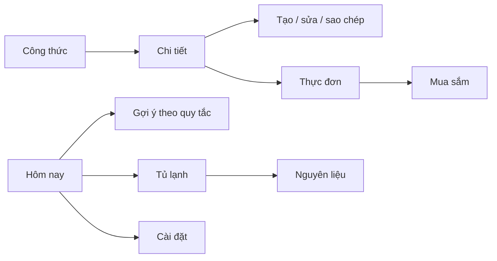

# Thiết kế UI/UX NauGi

## Người dùng và nhu cầu

Đây là persona giả định phục vụ thiết kế, chưa có kết quả khảo sát.

| Persona | Bối cảnh | Nhu cầu |
|---|---|---|
| Sinh viên tự nấu | Ít thời gian, tủ lạnh nhỏ, mua đồ bằng điện thoại | Tìm món nhanh, tận dụng đồ sẵn có, danh sách mua khi mất mạng |
| Người chuẩn bị bữa cho gia đình nhỏ | Lên thực đơn nhiều bữa, thay đổi khẩu phần | Lưu kế hoạch theo ngày, gộp nguyên liệu, theo dõi hạn dùng |

Ưu tiên đọc nhanh bằng một tay; thao tác chính có nhãn tiếng Việt. Nhãn hạn dùng và trạng thái không chỉ dựa vào màu. Ước tính dinh dưỡng cần nêu phần dữ liệu thiếu.

## Điều hướng và luồng

Thanh dưới gồm Hôm nay, Công thức, Thực đơn, Mua sắm. Tủ lạnh và Cài đặt mở từ thanh trên; chi tiết, trình sửa, danh mục nguyên liệu và gợi ý là màn hình phụ. Mở app vào nội dung, không có cửa đăng nhập.



Luồng 1: tải danh mục → lọc/tìm công thức → xem nguyên liệu/bước nấu → chọn ngày, bữa, khẩu phần → lưu thực đơn local.
Luồng 2: nhập nguyên liệu/hạn dùng → xem món có nguyên liệu phù hợp → thêm vào thực đơn → sinh danh sách mua, tùy chọn trừ tủ lạnh.
Luồng 3: công thức mới → nhập đủ trường → lưu online → nhận kết quả API → danh sách/cache cập nhật. Offline cần thông báo lỗi, giữ nội dung nhập.
Luồng 4: bật yêu thích/chọn ảnh → lưu cục bộ → mở lại app → vẫn có trên máy đó.

## Danh mục màn hình

| Màn hình | Nội dung / hành động |
|---|---|
| Hôm nay | Ngày, bữa đã lên lịch, nguyên liệu gần hạn, gợi ý, tổng dinh dưỡng |
| Công thức | Danh sách, tìm tên, lọc, yêu thích, tải lại, tạo mới |
| Chi tiết | Khẩu phần, nguyên liệu, bước nấu, dinh dưỡng; yêu thích, thêm thực đơn, sao chép; sửa/xóa món thường |
| Trình sửa | Tên, mô tả, nhóm, thời gian, khẩu phần, ăn chay, nguyên liệu/đơn vị, bước, ảnh local |
| Thực đơn | Chọn ngày/bữa, thêm/xóa món, số người, bản chụp món |
| Tủ lạnh | Các lô nguyên liệu, lượng, đơn vị, hạn dùng; thêm/sửa/xóa |
| Mua sắm | Danh sách theo thực đơn hoặc tự tạo; đánh dấu đã mua, sửa/xóa |
| Cài đặt | Khẩu phần, thời gian tối đa, ăn chay, tránh nguyên liệu, nhắc hạn và chuyển dữ liệu cũ |
| Nguyên liệu | Tra cứu, tạo/sửa tên và dữ liệu định lượng/dinh dưỡng qua API |
| Gợi ý | Danh sách xếp hạng, lý do có sẵn/sắp hết hạn, mở chi tiết |

sample=true chỉ có sao chép, không sửa/xóa từ UI. Sao chép thành món dùng chung mới. Nhãn giao diện cần nói rõ công thức là danh mục dùng chung; yêu thích, ảnh và dữ liệu bếp chỉ ở thiết bị.

## Wireframe chữ

Các sơ đồ dưới mô tả bố cục, không phải ảnh chụp từ app.

```text
HÔM NAY                         [Tủ lạnh] [Cài đặt]
Hôm nay, bạn muốn nấu gì?
[Bữa ngon từ những gì sẵn có] [Khám phá gợi ý]
Dùng sớm nhé: tên — lượng — hạn
Thực đơn hôm nay: tên món — bữa — khẩu phần
Dinh dưỡng / phần dữ liệu còn thiếu
[Hôm nay] [Công thức] [Thực đơn] [Mua sắm]

CÔNG THỨC                       [+]
[Tìm tên món...]
[Bộ lọc / yêu thích]
[Cảnh báo cache hoặc lỗi + Thử lại]
[Ảnh] Tên món         [tim]
      phút • số người • nhãn mẫu
...

CHI TIẾT
[Quay lại] Tên món             [tim]
[Ảnh cục bộ / hình thay thế]
Mô tả — thời gian — khẩu phần
Nguyên liệu + lượng/đơn vị
Các bước 1, 2, 3...
Dinh dưỡng + cảnh báo thiếu
[Thêm vào thực đơn] [Sao chép]
[Sửa] [Xóa] chỉ cho món thường

THỰC ĐƠN
[Ngày trước] [Ngày đang chọn] [Ngày sau]
Sáng / Trưa / Tối
[Tên món — số người — Xóa]
[Thêm món]
[Tạo danh sách mua]

TỦ LẠNH                       [+]
Nguyên liệu — số lượng — đơn vị
Hạn yyyy-MM-dd — trạng thái — [Sửa] [Xóa]
[Danh mục nguyên liệu]

MUA SẮM
[Chọn / tạo danh sách]
[ ] Tên — lượng — đơn vị
[x] Đã mua
[Tạo từ thực đơn] [Trừ tủ lạnh]

CÀI ĐẶT
Khẩu phần [2] — thời gian [45]
Ăn chay [ ] — nguyên liệu tránh [...]
Nhắc hạn [ ] + trạng thái quyền
Dữ liệu cũ: số bản nháp / nhập có xác nhận
```

## Design tokens từ theme

| Token | Giá trị / cách dùng |
|---|---|
| Màu nền | #FAF8F2 |
| Màu chính | #386B4E |
| Màu phụ | #BF7547 |
| Bề mặt card/input | Trắng |
| Kiểu chữ | Material 3, font hệ thống hỗ trợ tiếng Việt; tiêu đề đậm |
| Bán kính | Input 16, card 20, nút chính 14; banner trang chủ 24 |
| Khoảng cách | Các bước 6/8/16/20/24; nội dung chính thường padding 20 |
| Nút chính | Chiều cao tối thiểu 48 logical px |
| Trạng thái | Spinner/tiến trình; lỗi có chữ và retry; rỗng có hướng dẫn |

Mục tiêu tiếp cận: tooltip cho icon, chữ đọc được khi tăng cỡ chữ, vùng chạm phù hợp, bàn phím không che nút lưu. Chưa khẳng định đạt WCAG hoặc đã chạy TalkBack; cần kiểm tra theo testing-guide.

## Bốn trạng thái và dữ liệu cũ

| Phạm vi | Loading | Success | Empty | Error + retry |
|---|---|---|---|---|
| Khởi tạo SQLite/app | Chỉ báo khởi tạo | Vào nội dung | Notebook mới | Thông báo không đọc được + thử lại |
| Công thức/nguyên liệu | Chỉ báo tải, giữ cache nếu có | Danh mục và thao tác | “Chưa có…” hoặc không có kết quả lọc | Lỗi mạng/HTTP/JSON, nút tải lại; cache vẫn đọc |
| Chi tiết | Trạng thái danh mục đang tải | Công thức | Món không còn tồn tại | Lỗi tải + retry; không báo “đã xóa” chỉ vì mạng hỏng |
| Hôm nay/gợi ý | Theo tải dữ liệu phụ thuộc | Dữ liệu/gợi ý | Chưa có bữa/món phù hợp | Cảnh báo danh mục lỗi + retry, giữ phần local |
| Thực đơn/tủ lạnh/mua sắm/cài đặt | Khởi tạo hoặc lưu | Nội dung local | Chưa có mục, gợi ý thêm | Lỗi đọc/ghi local, có cách thử lại; không báo thành công giả |
| Tạo/sửa danh mục | Nút lưu bận, ngăn gửi nhiều lần | Chỉ sau phản hồi REST | Trường bắt buộc chưa nhập có validation | Giữ form, hiện lỗi; timeout hướng dẫn tải lại kiểm tra trước khi gửi lại |

Khi lọc không có kết quả, người dùng có thể bỏ bộ lọc. Khi cache cũ tồn tại và refresh hỏng, hiển thị dữ liệu kèm thông báo đang dùng bản lưu; không trình bày như lần tải mạng thành công.

## Ảnh và bằng chứng

Chưa đính kèm ảnh chụp màn hình chạy thật trong tài liệu này. Sau khi chạy Android, lưu ảnh thật ở docs/asset/ và ghi thiết bị, kích thước, ngày chụp. Không dùng wireframe làm minh chứng chạy được.
